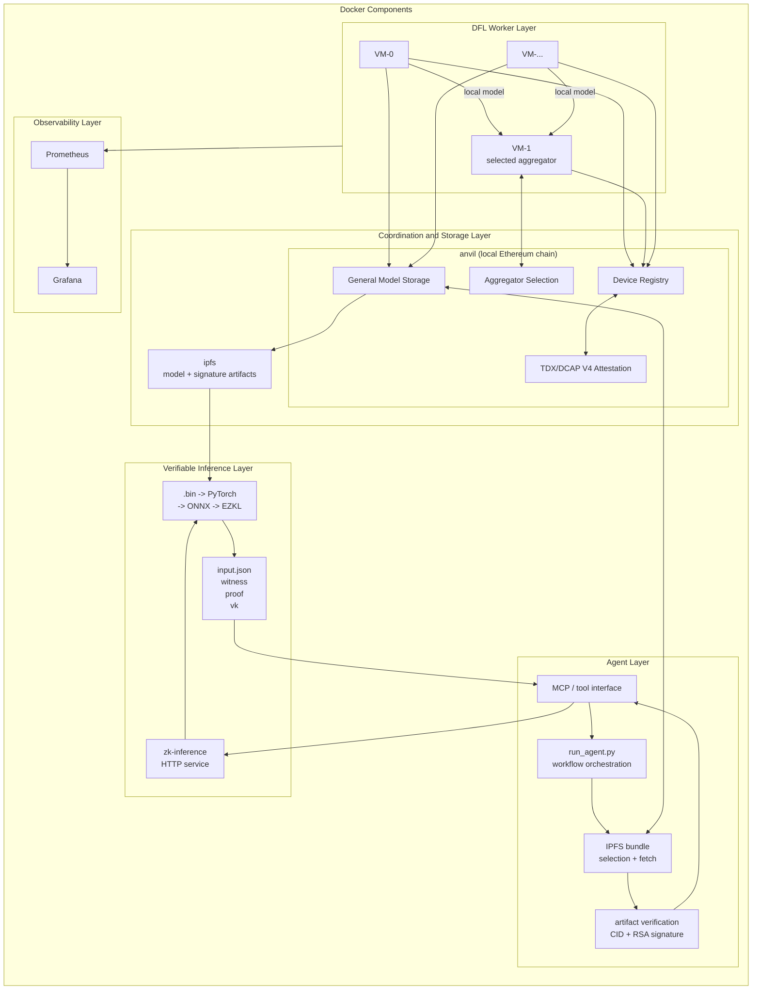

# Master Thesis Prototype: Trusted DFL and Verifiable Inference

[](https://github.com/uZhW8Rgl/vita-fl/actions/workflows/ci.yml?query=branch%3Aphala_app_key)

This repository contains a proof-of-concept implementation for trusted decentralized federated learning (DFL), model provenance, and verifiable single-image inference.

The current prototype combines:

- decentralized CNN training with multiple worker nodes,
- smart-contract-based coordination and model metadata,
- immutable per-round aggregation thresholds, deterministic equal-weight
  federated averaging, and TEE-signed input/output statements with atomic
  model publication,
- local IPFS/Kubo storage for global model artifacts,
- TDX/DCAP quote verification through Solidity contracts,
- RSA signature verification for global model artifacts,
- EZKL-based zero-knowledge inference for a single dataset image,
- AIR/TDX-bound ChestMNIST inference in a digest-pinned Phala TEE,
- SCITT-CCF registration and local verification of transparency receipts,
- and a local LangChain/Ollama agent that orchestrates contract lookup, artifact verification, and proof generation.


## Preview, recreate, or delete

Run these commands from this directory with your configured deployment profile:

```bash
bash phala/start.sh

# Preview changes without applying or deleting resources.
bash phala/start.sh --dry-run

# Delete the existing demo and create a fresh runtime.
bash phala/start.sh --recreate

# Delete the deployment, including leftover worker CVMs.
bash phala/start.sh --destroy
```

`--recreate` and `--destroy` erase the current run's chain state, IPFS data, and
training progress. After recreation, start training yourself in the UI.

## Architecture

The diagram below shows the main runtime components and their connections.

### Runtime Component Overview



## Stable UI address through GitHub Pages

The `Publish Phala UI Redirect` workflow publishes a small redirect at
`https://uzhw8rgl.github.io/vita-fl/`. It runs after successful Phala image
publish/deploy workflows and reads the latest successful deployment's public
UI endpoint from its Actions logs. Deployment completion time determines the
target, so builds that finish out of order cannot select an older runtime.
Stale-build skips do not supply a new endpoint. Before publishing, the workflow
checks `/ui-health`; an unavailable UI leaves the existing Pages deployment in
place and fails the redirect workflow.

One-time setup, after pushing the redirect workflow to the default branch:

1. Open **Settings → Pages → Build and deployment** and select **GitHub Actions**
   as the source.
2. In **Actions → Publish Phala UI Redirect**, choose **Run workflow** to publish
   the current UI without redeploying Phala. Pushing changes to the redirect
   builder also starts this workflow.
3. Use `https://uzhw8rgl.github.io/vita-fl/` as the stable entry point. The browser
   then switches to the current Phala URL; the existing UI login still applies.

The artifact contains only `index.html`, `endpoint.json`, and `.nojekyll`.
It contains no deployment configuration, Terraform state, credentials or logs.
No DuckDNS token or additional cloud server is needed. Redirect code changes
are outside the Phala image publishers' path filters, so updating this entry
point does not itself deploy or reset the runtime. GitHub Pages changes can
take a few minutes to propagate, and a fresh Phala runtime can be unavailable
during recreation. Local deployments require a separate Pages workflow run;
this redirect discovers deployments completed through GitHub Actions.

See [GitHub Pages custom workflows](https://docs.github.com/en/pages/getting-started-with-github-pages/using-custom-workflows-with-github-pages).
