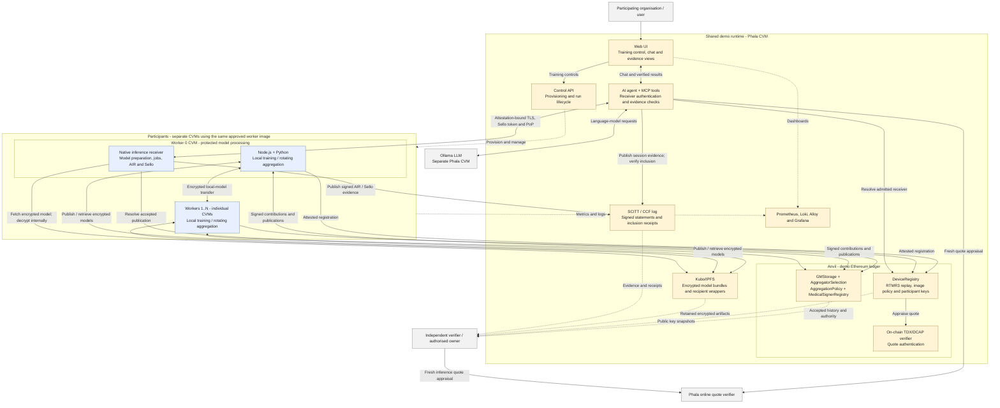

# Master Thesis Prototype: Trusted DFL and Verifiable Inference

[](https://github.com/uZhW8Rgl/vita-fl/actions/workflows/ci.yml?query=branch%3Akms)

This repository contains a proof-of-concept implementation for trusted decentralized federated learning (DFL), model provenance, and verifiable single-image inference.

The current prototype combines:

- decentralized CNN training with multiple worker nodes,
- smart-contract-based coordination and model metadata,
- fixed per-round collection targets and deadlines, deterministic equal-weight
  federated averaging, and TEE-signed input/output statements with atomic
  model publication,
- local IPFS/Kubo storage for global model artifacts,
- TDX/DCAP quote verification through Solidity contracts,
- RSA signature verification for global model artifacts,
- an optional EZKL-based zero-knowledge inference backend for local experiments,
- AIR/TDX-bound ChestMNIST inference in a digest-pinned Phala TEE,
- SCITT-CCF registration and local verification of transparency receipts,
- workload-scoped random participant keys held in memory and private tmpfs,
- and a LangChain/Ollama agent using MCP tools, authenticated TEE calls, and evidence verification.


## Preview, recreate, or delete

Run these commands from this directory with your configured deployment profile:

```bash
bash phala/start.sh

# Preview changes without applying or deleting resources.
bash phala/start.sh --dry-run

# Delete the existing demo and create a fresh runtime.
bash phala/start.sh --recreate

# Delete the deployment, including leftover worker CVMs.
bash phala/start.sh --destroy
```

`--recreate` and `--destroy` erase the current run's chain state, IPFS data, and
training progress. After recreation, start training yourself in the UI.

## Architecture

The diagram shows the selected Phala deployment with native TEE inference.
Worker 0 performs training and serves inference inside the same worker image
and CVM. Aggregation rotates among admitted workers; the agent invokes bounded
tools and checks evidence. The optional [ZK backend](zk_inference/README.md)
is a separate code path and is disabled in this Phala profile.

### Runtime Component Overview



Blue nodes perform protected model processing; yellow nodes provide shared
runtime services. Solid arrows show runtime interactions, and dashed arrows
show lifecycle control, external auditing, or observability.

Membership follows successful attested registration, without preselected
participant addresses. The bootstrap workload snapshots all registered members
for the current training; later admissions do not rewrite its encrypted recipients.

The default ephemeral profile creates fresh action, RSA, Sello and AIR keys per
workload. The explicit onchain-KMS profile restores the same authenticated encrypted
key bundle after an authorized boot and reattests enrollment without resetting
contribution scores. Plaintext participant keys remain in memory/private tmpfs.
The KMS profile is locally tested. Hosted onchain KMS requires Base/Ethereum;
the [own dstack KMS profile](kms/README.md) uses the original contracts on Anvil.
The current Phala workspace blocks custom KMS URL updates, so its real key-release
path is not cloud-validated. See [KMS setup and validation limits](phala/README.md#shared-policy-onchain-kms-branch-kms).
Inference decrypts models inside Worker 0 and returns predictions and evidence
to the agent.
Independent checks use accepted ledger state, authentic policy references,
retained artifacts and statements; owner-content checks additionally require
the owner's disclosure capability.
