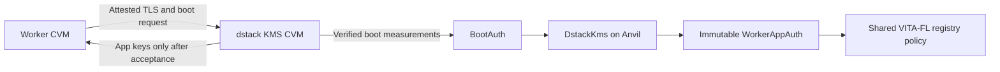

# Own dstack KMS with Anvil

This opt-in path uses the **original dstack v0.5.9 KMS binary and contracts**.
The full motivation, identity/score limits, tested scopes, provider restrictions,
and considered Anvil/Sepolia split are recorded in [INVESTIGATION.md](INVESTIGATION.md).
The governing policy can run on the same Anvil chain as VITA-FL. Phala's managed
KMS does not consult that chain. BootAuth is an HTTP adapter to the original
`DstackKms` contract; it neither verifies quotes nor holds secret keys.



The real KMS performs RA-TLS/DCAP and OS-image verification before consulting
the policy. Our factory creates an immutable AppAuth from the exact, approved
worker manifest. An operator cannot add another Compose hash or upgrade that
AppAuth. Its address is the worker's dstack app ID. Creating the AppAuth is
permissionless and does not itself grant DFL membership; live quote-bound
registration in the registry remains necessary.

An unchanged app/workload can regain its KMS-derived key and decrypt its retained
participant bundle after a restart. A replacement Compose under that app ID is
denied by its immutable AppAuth. Runtime keys remain private and volatile; only
the authenticated encrypted bundle persists. Losing the bundle still loses its
random RSA/signing identities. Stable keys preserve reputation when the same
participant re-registers. They **do not prevent someone creating a new app and
wallet**; open admission does not establish a unique human or organisation.

## Current validation and Phala limitation

The local HTTP → BootAuth → Anvil → original `DstackKms` → `WorkerAppAuth` path
has been exercised with real transactions. Boot inputs in those tests are
synthetic; they are not measurements of DCAP verification or real key release.
The sanitized local result summary is in `validation/local-checks-20261015.json`:
167 Solidity tests, 118 Node runtime tests, the additional BootAuth/Anvil checks,
and 10 Python KMS configuration/provenance tests passed. The BootAuth image builds
and both Compose configurations validate.

On 2026-10-15 the current Phala workspace returned HTTP 403 to an attempted
network configuration write using **exactly the existing KMS URLs**, with
`restart=false`: `Updating KMS URLs is not enabled for this workspace`.
The sanitized result is in `validation/phala-preflight-20261015.json`.
No CVM was started and no KMS URL was changed.

Consequently this branch has no successful hosted Phala boot against our own
KMS, and no cloud evidence yet that it withholds the old key from a substituted
image. Either Phala must enable custom KMS configuration for the workspace, or
the CVMs must run under a dstack VMM we control. Enabling the URL option alone
does not settle other compatibility issues: local SGX key-provider availability,
supported OS measurements, app-ID provisioning and network reachability still
need testing. The managed PHALA provisioning API's app-ID rules must not be
treated as equivalent to VMM `--app-id`.

## Local policy stack

From the repository root:

```sh
docker compose -f kms/compose.yaml up -d anvil
```

This starts a separate chain on `127.0.0.1:18545`, with its own persistent volume.
It neither resets the existing runtime nor publishes the Anvil development RPC
to the internet. Run the existing registry deployment on this chain, including
its reviewed image and role policies. Then deploy the original KMS policy:

```sh
cd smart_contracts
forge script script/DeployOwnKms.s.sol:DeployOwnKms --rpc-url http://127.0.0.1:18545 --broadcast
```

Required environment: `ETH_WALLET_PRIVATE_KEY` (chain-policy administrator) and
`KMS_OS_IMAGE_HASH` (the explicitly verified dstack OS hash, not the worker's
container digest). The script deploys the original UUPS implementation and an
initialized ERC1967 proxy, approves that OS, and leaves KMS self-admission denied
until its real measurement/device are authorized. No generic mutable per-app
implementation is configured. Administrative control of this chain and the KMS
root policy remains a declared trust assumption.

Set the printed `KMS_CONTRACT_ADDR`, return to the repository root, and start:

```sh
docker compose -f kms/compose.yaml up -d --build boot-auth
```

BootAuth listens on `127.0.0.1:18001`. It requires the expected chain ID and
contract code, preserves TCB status, and denies requests on malformed inputs or
RPC errors. Put it behind an authenticated, trusted HTTPS endpoint for a remote
KMS CVM. Do not expose Anvil's administrative API; Anvil is a development chain,
not a production consensus or access-control mechanism.

## Real KMS CVM

Render the manifest without disabling attestation or OS verification:

```sh
python kms/render_kms.py --auth-url https://auth.example \
  --image-download-url 'https://images.example/{OS_IMAGE_HASH}.tar.gz' \
  --admin-token-hash "$KMS_ADMIN_TOKEN_HASH" --output /tmp/kms-app-compose.json
```

Use an actual trusted OS-image source and SHA-256 of a freshly generated admin
token. The renderer fixes the official image digest and selects the **local
SGX key provider** for the KMS CVM's disk. The protected root keys are never
placed on an ordinary host bind mount or a disk restored through the same
mutable-app policy that caused the original failure. The dstack host must
actually provide this local SGX service; the manifest cannot supply it.

Deploy those exact bytes with the official dstack VMM CLI from the pinned
upstream revision, for example:

```sh
python vmm/src/vmm-cli.py --url "$VMM_RPC" deploy --name vita-fl-own-kms \
  --compose /tmp/kms-app-compose.json --image "$DSTACK_OS_IMAGE" \
  --vcpu 4 --memory 8G --disk 30 --port tcp:127.0.0.1:19201:8000
```

The CLI is part of upstream dstack, not this repository. Keep onboarding access
private (for example through a host tunnel) while the server is uninitialized.
`Onboard.GetAttestationInfo` supplies the KMS measurement, device and OS hashes.
Check them against the intended deployment/attestation; then run:

```sh
forge script script/AuthorizeOwnKms.s.sol:AuthorizeOwnKms --rpc-url "$RPC_URL" --broadcast
```

Required environment: `KMS_AUTH_CONTRACT`, `KMS_AGGREGATED_MR`, `KMS_DEVICE_ID`,
`KMS_OS_IMAGE_HASH`, `ETH_WALLET_PRIVATE_KEY`. Use upstream onboarding to bootstrap
and finish setup. Retain/check the public bootstrap attestation and root CA,
then make the initialized KMS reachable at its configured HTTPS domain. No
`dev` authorization mode or self-authorization bypass is supplied here.

Inspect metadata using that explicitly checked CA:

```sh
node kms/inspect-kms.mjs https://kms.example root-ca.crt
```

This verifies normal HTTPS against the supplied CA and checks the returned KMS
identity; it is **not** an independent DCAP bootstrap verifier. The printed
`key_provider_hash` is keccak256 of the exact dstack 0.5.9 JSON event containing
the root CA's DER SubjectPublicKeyInfo. Compare it with a genuine worker's
measured `key-provider` event before accepting a live deployment.

Configure the registry before first enrollment using `ConfigureKms.s.sol`
(`REGISTRY_ADDRESS`, `KMS_AUTH_CONTRACT`, `KMS_KEY_PROVIDER_HASH`, administrator
key). Each participant then selects the KMS runtime-key profile documented in
`../phala/README.md` and creates its own immutable app policy:

```sh
node kms/register-worker.mjs exact-worker-app-compose.json https://kms.example root-ca.crt
```

Required environment: `RPC_URL`, `REGISTRY_ADDRESS`, and the participant's own
`KMS_DEPLOYER_PRIVATE_KEY`. The helper checks the real KMS metadata against its
pinned CA, the RPC chain, the factory/KMS/registry binding, and the registry's
measured key-provider pin. It prints the `app_id` and exact `compose_hash`.
Use that app ID with VMM `deploy --app-id ... --kms-url https://kms.example`.
Use the official CLI's encrypted-environment flow for secrets; never bake wallet
private keys into a public manifest. The manifest must already have its reviewed
KMS runtime flags, private tmpfs, and ciphertext-only participant-state volume.

## Reproduce checks

```sh
cd smart_contracts
forge test
cd ../dfl/node_server
npm ci
npm run build
REQUIRE_ANVIL_TESTS=1 npm test
node --test ../../kms/*.test.mjs ../../phala/test_kms_provision.mjs
REQUIRE_ANVIL_TESTS=1 node --test ../../kms/anvil.integration.mjs
cd ../..
python -m pytest -q kms
```

The Anvil HTTP integration requires compiled artifacts in `smart_contracts/out`
(override with `KMS_ARTIFACT_DIR`). It covers unchanged workloads/restarts,
changed Compose, unapproved OS/app, TCB status, two independent operators,
KMS self-admission and shared-policy revocation. Existing runtime tests exercise
stable RSA/action/receipt identities, ciphertext integrity and score continuity.
CI runs these checks; no cloud experiment is launched by CI.

The permission probe can be repeated explicitly without changing URLs:

```sh
python kms/preflight_phala.py --env-file .env.phala.anvil --cvm-id CVM_ID \
  --check-network-permission --output /tmp/kms-preflight.json
```

## Upstream provenance

Contract logic comes unchanged from dstack
`282eeb27d22d8f091ad0fa5a90e638f85cf68751` (`v0.5.9`), with the required
OpenZeppelin 5.4.0 source closure. Only the import namespace is rewritten from
`@openzeppelin/` to `dstack-oz/`, isolating these dependencies from the existing
PCCS contracts. Tests reverse that rewrite and verify the original source hashes.
Licenses, package archive hashes and original/local per-file SHA-256 values are
retained in `smart_contracts/vendor/dstack-v0.5.9`.
The renderer pins `dstacktee/dstack-kms` to
`sha256:e959bc5b4c7664d26543801073cc445d806fcea49a240881f707d1998e2d871c`;
the downloaded binary reports the same upstream revision.

Primary sources:
[original KMS contract](https://github.com/Dstack-TEE/dstack/blob/v0.5.9/kms/auth-eth/contracts/DstackKms.sol),
[official deployment](https://github.com/Dstack-TEE/dstack/blob/v0.5.9/docs/deployment.md),
[VMM API](https://github.com/Dstack-TEE/dstack/blob/v0.5.9/vmm/rpc/proto/vmm_rpc.proto),
[Phala network configuration](https://docs.phala.com/api-reference/cvms/update-kmsgateway-urls).
